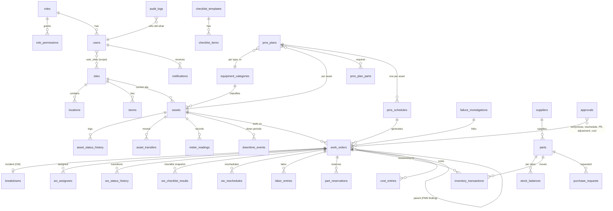

# CMMS architecture and design

## 0. Review of the existing project

The repository `housing-dashboard-data` held only `Housing Database.xlsx`. That file is a data workbook for the FTB Supply & Production dashboard, with sheets for project overview, monthly history and annual history per housing site. It contains **no** maintenance, equipment, work order or user data, and no application code, database, authentication or deployment setup.

So nothing could be reused as a CMMS module. The CMMS was built new in `cmms/`. The workbook was used only for the **site master list**:

- Batulao Parkhomes
- Batulao Impression
- Calauan (Alora + Amani)
- Gentri
- Naic
- The Cove Lipa
- Sights Bay
- Tayabas

Taytay and the Central Precast Factory were added from the brief. All sites can be edited in the app.

## 1. Application architecture

```
Browser (desktop / phone) ──HTTPS──► Node.js + Express API ──► SQLite (WAL) database
  Vanilla-JS SPA, no build step       • session auth (scrypt, httpOnly cookie)    • relational schema, FKs, CHECKs
  Chart.js for charts                 • RBAC + site scoping on every request      • append-only triggers (audit,
  BarcodeDetector QR scan             • services hold all business rules            inventory txns, WOs, assets)
                                      • scheduler: PMS generation + alerts (hourly)
                                      • file uploads to disk (validated), Excel I/O
```

Key choices:

- **Business rules live in server services, never in the browser.** The UI only reflects what the API allows. For example, the API returns `transitions` and `can` flags for each work order.
- **One status engine.** `services/assetStatus.js` is the single place where equipment status and downtime are derived:
  - Equipment status comes from open work orders.
  - Every status change writes `asset_status_history` and splits, opens or closes `downtime_events`.
  - This keeps status, downtime and availability consistent.
- **One work order engine.** `services/workorders.js` serves PMS, corrective, inspection and other work.
  - Allowed transitions and their required permissions are data (`wo_transitions`), so they are configurable.
  - Completion guards (required data, independent verification) are code, so they cannot be configured away.
- **Calculations are traceable.** `services/analytics.js` returns each KPI with its numerator, denominator, formula, exclusions and the underlying record IDs. The dashboard can show how a figure was computed and drill down to the records.
- **Stack.** Node 20+, Express 4 and better-sqlite3. The app runs on a single small server with no external services. The data layer is thin and the SQL is standard, so moving to PostgreSQL later is mechanical.
- **Time and money.**
  - Instants are stored as UTC ISO strings.
  - Calendar dates (due dates, work dates, cost dates) are Asia/Manila dates. Manila is UTC+8 with no daylight saving.
  - Inputs without a timezone are read as Manila time.
  - Money is PHP, stored as REAL with 2-decimal rounding.

## 2. Data model

The full DDL is in `server/schema.sql`. Main entities and relationships:



Integrity rules enforced in the database:

- **Unique keys:** asset code; manufacturer + serial number; usernames (case-insensitive); WO, breakdown, PR and transaction numbers; one schedule per plan and asset; one cost entry per source (`UNIQUE(source_type, source_id)`, which prevents double-counted parts and labor).
- **CHECK constraints:** enumerations, labor hours between 0 and 24, downtime `end ≥ start`, reserved quantity ≥ 0.
- **Foreign keys** on every relationship.
- **Append-only triggers:**
  - `audit_logs` cannot be updated or deleted.
  - `inventory_transactions`, `work_orders` and `assets` cannot be deleted. Records are cancelled, voided or archived instead.
- **Concurrency:**
  - Work orders carry a `version` column; a stale update returns 409.
  - Breakdowns, issues and transactions carry a `client_request_id`, so a double-tap or retry returns the original record instead of creating a duplicate.

Document numbering: `PREFIX-YYYY-NNNNN`, restarting each year.

| Prefix | Document |
|---|---|
| `PM` | PMS work order |
| `CM` | Corrective work order |
| `IN` | Inspection work order |
| `OT` | Other work order |
| `BR` | Breakdown report |
| `IT` | Inventory transaction |
| `PR` | Purchase request |
| `FI` | Failure investigation |

## 3. Screens

| Screen | Route | Main roles |
|---|---|---|
| Login, profile & change password | `#/login`, `#/profile` | all |
| Executive dashboard (KPIs, drill-down, charts) | `#/dashboard` | manager, supervisor, viewer, custodian |
| Equipment registry and search | `#/assets` | all with `asset.view` |
| Equipment detail: history, breakdowns, PMS, status log, transfers, meters, documents, QR | `#/assets/:id`, `#/a/:code` (QR) | all with `asset.view`; actions depend on permissions |
| Register / edit equipment | `#/assets/new`, `#/assets/:id/edit` | admin, manager, supervisor |
| QR scan | `#/scan` | all with `asset.view` |
| Breakdown report (mobile-first, about 5 taps) | `#/report` | all with `breakdown.report` |
| Work order register (filters, overdue / unassigned / waiting-parts highlighting) | `#/wo` | supervisors, managers, custodians, viewers |
| My jobs | `#/my` | technicians |
| Work order execution: checklist, labor, parts, findings, failure analysis, testing, costs, photos, notes, approvals | `#/wo/:id` | assigned technicians, supervisors |
| PMS plans and schedules | `#/pms`, `#/pms/plans/:id` | supervisors, managers |
| PMS calendar (month grid / list, with forecast) | `#/pms/calendar` | all with `pms.view` |
| Breakdown register; failure investigations | `#/breakdowns`, `#/investigations` | supervisors, managers |
| Equipment availability board | `#/availability` | all with `downtime.view` |
| Technician workload | `#/team` | supervisors, managers |
| Spare parts, transactions, adjustments; part detail | `#/inventory`, `#/inventory/parts/:id` | storekeepers, supervisors |
| Purchase requests | `#/prs` | storekeepers, managers |
| Maintenance cost dashboard and entries | `#/costs` | managers, supervisors, viewers |
| Reports and exports (CSV, XLSX, print to PDF) | `#/reports`, `#/reports/:id` | all with `report.view` |
| Notifications | `#/notifications` | all |
| Administration: users & passwords, roles, sites & master data, checklists, settings & escalation, workflow, audit log, Excel import | `#/admin/*`, `#/import` | administrators |

The UI is mobile-first:

- touch targets of at least 42–44 px
- a collapsible navigation menu
- tables that scroll horizontally
- camera capture for photos
- print stylesheets

## 4. Workflows

### 4.1 Corrective maintenance / breakdown

```
Reported ─► Under Assessment ─► Approved/Assigned ─► In Progress ─► For Testing ─► For Verification ─► Closed
   │                │                                  │   ▲    ▲            │ test failed      │ rework
   │                │                                  ▼   │    │            └──► In Progress ◄─┘
   │                │                     Waiting for Parts ◄──► Waiting for External Service
   └────────────────┴──► Cancelled (reason; optional "invalid report" voids failure count and downtime)
```

- **Report.** Any user with `breakdown.report` can report, either from the form or after scanning the QR code. They select the equipment, severity, impact (stopped / running with restriction / no impact), category and description; time occurred, safety and production impact, temporary action and a photo are optional.
  - The report creates a breakdown record and a CM work order.
  - Severity sets the priority.
  - Impact "stopped" sets the equipment to **Breakdown** and opens **unplanned downtime**. Downtime starts at the time occurred, if given.
  - "Running with restriction" sets **Running with Restriction**, which is not downtime.
- **Duplicates.** If an open CM already exists for the equipment, the reporter is warned and must confirm. A double submission returns the original report.
- **Notifications.** A critical report notifies the site's supervisors and managers immediately. A repeat failure (by default, 2 or more in 30 days) flags the WO as a recurrence and notifies the people who manage investigations.
- **Execution.** Starting work sets **Under CM**. Waiting states change the equipment status and the downtime category (waiting for parts, external service). "Repair done" sets **For Inspection/Testing** and records the actual completion time.
- **Submit for verification requires:**
  - work performed
  - actual start
  - labor hours greater than 0
  - all required checklist items
  - root cause (with remarks if "Other")
  - failure mode
  - failed component
  - repair action
  - testing results
  - a passed functional test
- **Close (`wo.close`).**
  - The closer must not be the submitter, and must not have logged labor on the job. This is controlled by the `require_independent_verification` setting.
  - Closing records the verifier and closer and an approval record.
  - It returns the equipment to **Available** at the return-to-service time. That time defaults to now, must be at or after actual completion, and cannot be in the future.
  - It closes downtime, approves the system-generated parts and labor costs, and releases unused reservations.
- **Investigations.** Supervisors link repeat breakdowns to a failure investigation. An investigation records the root cause and preventive actions, can raise follow-up inspection work orders, and can be closed only once the root cause and preventive actions are recorded.

### 4.2 Preventive maintenance

```
Plan (per category or asset; calendar / hours / km; checklist; parts)
  └─► Schedule per asset (next due date / next due meter)
        └─► Generator (hourly + on demand): due − lead window reached and no open WO ─► PMS WO "Scheduled"
              Scheduled ─► Assigned ─► In Progress ─► (Waiting…) ─► [For Testing] ─► For Verification ─► Closed
                   │           │                                                                     │
                   ├───────────┴─► Missed (reason, non-compliant) ─► schedule moves to next cycle    └─► schedule advances
                   └─► Cancelled (reason, excluded from compliance)
              Reschedule (pms.reschedule): new due date + reason + authoriser recorded
```

- **Frequencies:**
  - Calendar: daily, weekly, monthly, quarterly, semiannual, annual, or every N days.
  - Meter: operating hours or km.
- **Schedule basis.** Each plan uses one of two bases:
  - **Fixed:** the next due date is the previous due date plus the interval, rolled forward past the completion date.
  - **Floating:** the next due date is the completion date (or meter reading) plus the interval.
- **Scope.** Category plans automatically include equipment registered later. Decommissioned equipment is excluded.
- **Classification.** A PMS work order stays type PMS whatever is found. Defects beyond the PMS scope are handled with **"+ Corrective WO from finding"**, which creates a CM linked by `parent_wo_id`.
- **No automatic completion.** A PMS is never completed automatically. It needs the checklist, labor, condition after maintenance and work performed (plus the meter reading for meter plans), and closure by an independent verifier.
- **Alerts:**
  - Upcoming PMS and overdue PMS (past due) each raise one notification per WO.
  - Escalation rules can notify managers after N hours overdue.

### 4.3 Equipment status rules

| Status | Meaning | Counted as | Set by |
|---|---|---|---|
| Available | Serviceable, ready, not in use | up | user / WO closure |
| Operational | Serviceable and in use | up | user |
| Running with Restriction | In use with a known defect or limit | up (not downtime) | breakdown report or user |
| Standby | Serviceable, intentionally idle | up | user |
| Under Preventive Maintenance | PMS or inspection in progress | planned downtime | WO |
| Under Corrective Maintenance | Repair in progress | unplanned downtime | WO |
| Breakdown | Stopped by a failure, repair not started | unplanned downtime | breakdown report |
| Waiting for Spare Parts | Work stopped pending parts | waiting-for-parts downtime | WO |
| Waiting for External Service | Waiting for a supplier or service provider | external-service downtime | WO |
| For Inspection or Testing | Work done; test or verification pending | planned or unplanned (by WO type) | WO |
| Decommissioned | Retired | excluded from availability and PMS | user (only with no open WOs) |

- **Return to service.** While a work order holds the equipment, it can return to service only by **verification and closure** of that work order. A manual status change is refused (409).
- **Several open WOs.** If several open work orders hold the same equipment, the most severe status applies, in this order: Breakdown, Waiting for Parts, Waiting for External Service, Under CM, Under PM, For Testing, Running with Restriction.

### 4.4 Inventory

- **Balances change only through posted transactions:** receipt, issue, return, transfer out/in, and approved adjustment. Each transaction stores the balance after posting. `GET /inventory/reconcile` and the integrity check confirm that every balance equals the sum of its transactions.
- **Issue** requires an open work order, a recipient and an available quantity (on hand minus reservations held by other WOs). It records the asset and site from the WO and creates a PARTS cost entry.
- **Return** is limited to the quantity issued to that WO (net) and creates a cost credit.
- **Reservations** hold stock for approved work orders and are released on closure or cancellation.
- **Negative balances** are refused unless the `allow_negative_stock` setting is on (off by default).
- **Adjustments** need a documented reason and are posted only after approval by a different user with `inventory.approve`.
- **Purchase requests** follow Submitted → Approved (not by the requester) → Ordered (PO reference) → Partial / Received (through receipts linked to the PR). They can also be Rejected or Cancelled.
- **Valuation** uses moving-average cost.
- **Low stock:** a part at or below its reorder point notifies storekeepers and PR approvers once per condition. The dashboard KPI counts parts below their minimum level.

### 4.5 Costs

- **Categories:** parts, internal labor, external labor, third-party service, rental due to breakdown, other.
- **Estimate vs actual** is a separate field on each entry. KPIs and cost totals use actual costs only.
- **Automatic costs.** Parts costs come from inventory issues and returns, at moving-average cost. Internal labor comes from labor entries: hours × the technician's rate, or the default rate. Each source is costed **once**, enforced by a unique index.
- **Manual entries:**
  - Internal labor cannot be entered manually.
  - Manual parts costs require a direct-purchase reference.
  - Entries with a duplicate reference on the same WO raise a warning.
- **Approval.** System-generated costs are approved when the WO is closed. Manual entries are approved by someone other than the person who recorded them (`cost.approve`). The finance export contains approved actual costs only.

## 5. KPI formulas and validation rules

Each KPI is shown with its numerator, denominator, period and exclusions when you open it on the dashboard. A KPI with no valid denominator shows **"No data"**, never 0 % or 100 %.

| KPI | Formula / rule |
|---|---|
| Total registered equipment | Non-archived equipment, excluding decommissioned (the decommissioned count is noted). Current snapshot. |
| Available / operational | Status Available, Operational or Standby. Running with Restriction is noted separately. |
| Under maintenance | Under PM, Under CM, Waiting for Parts, Waiting for External Service, For Testing. |
| Breakdown | Status Breakdown. |
| **Availability %** | (Scheduled operating time − qualifying downtime) ÷ scheduled operating time × 100. See the rules below this table. |
| **PMS compliance %** | PMS completed within the window [due − `pms_early_window_days` (7), due + `pms_tolerance_days` (3)] ÷ PMS due in the period × 100. See the rules below this table. |
| Overdue PMS | Open PMS work orders with due date before today. |
| Open corrective WOs / critical breakdowns | Open CM work orders / open CM with Critical priority. |
| Total downtime (h) | Elapsed calendar hours of non-voided downtime in the period, clipped to the period, merged per asset. |
| Total maintenance cost | Actual cost entries dated in the period, approved plus pending. Rejected and void entries are excluded. The approved and pending split is shown. |
| Parts below minimum | Active parts whose total on-hand quantity in the stores in scope is below the minimum level. |
| **MTTR** | Σ (actual completion − actual start) of corrective WOs closed with completion in the period ÷ their count. Mean **labor person-hours** and mean **elapsed downtime** per repair are shown separately and are not part of MTTR. |
| **MTBF** | Σ operating hours (scheduled operating time − all downtime) ÷ qualifying failures. A qualifying failure is a breakdown with impact "stopped", dated (occurred, else reported) in the period, and not cancelled as invalid. With zero failures MTBF is not computed and a note is shown. |
| Breakdown frequency | Count of valid breakdown reports by asset, category or site in the period. |
| **WO closure rate %** | WOs closed in the period ÷ (WOs open at the period start + WOs created in the period − WOs cancelled or missed in the period) × 100. |
| Maintenance backlog | Open WOs, with aging buckets (0–7, 8–30, 31–90, >90 days), counts by priority, Σ estimated labor hours, WOs waiting for parts, and WOs with outstanding reservations or open PRs. |
| Maintenance cost per equipment | Σ actual cost entries per asset and period, split by cost category. |

Availability rules:

- Scheduled time uses each site's operating days and hours (Asia/Manila). The default is Monday–Saturday 07:00–19:00; the factory runs 06:00–22:00.
- Time before commissioning (or before registration, when there is no commissioning date) is excluded, and so are decommissioned periods.
- Qualifying categories are unplanned, waiting for parts, external service and other. Planned downtime is included only when the `availability_include_planned` setting is on (it is on by default).
- Downtime intervals are merged, so overlapping events are never counted twice. Downtime outside operating hours is ignored. Ongoing downtime counts up to now.
- Fleet availability is time-weighted: Σ available hours ÷ Σ scheduled hours.
- Assumption: availability for transferred equipment uses its current site's operating schedule. Downtime events keep the site where they occurred.

PMS compliance rules:

- **Excluded from the denominator:** cancelled PMS, and open PMS still inside the tolerance window ("pending").
- **Non-compliant:** missed, overdue (open past tolerance), completed late, completed too early.
- **Rescheduling:** approved rescheduling moves the compliance due date (setting `reschedule_uses_new_due`, on by default). The rescheduled count is reported.

Validation rules (selection):

- **Dates:**
  - Commissioning cannot be before acquisition, and neither can be in the future.
  - Planned and actual completion must be at or after start.
  - Actual dates and return-to-service cannot be in the future.
  - Return-to-service must be at or after actual completion.
  - A breakdown's occurred time must be at or before its reported time, and at or after commissioning.
- **Meters:** a reading cannot be lower than an earlier reading or higher than a later one.
- **Labor:** each entry is more than 0 and at most 24 h. A person's total per day is at most 24 h. The work date cannot be in the future or before the WO was created.
- **Stock:** quantities must be greater than 0. Issues cannot exceed available stock. Returns cannot exceed the net quantity issued. Transfers cannot use reserved stock.
- **Required reasons:** cancellation, missed PMS, rework (return for verification), rescheduling, manual status change, transfer, adjustment, schedule change and manual downtime all need a reason.
- **No self-approval:** this covers WO verification and closure, stock adjustments, purchase requests and manual cost entries.

## 6. Roles (default permissions; editable under Roles & permissions)

| Role | Summary |
|---|---|
| System Administrator | Everything, including users, roles, settings, import and audit. Always holds every permission. |
| Maintenance Manager | All operational and approval permissions across permitted sites: closing, costs, PR and adjustment approvals, KPIs, reports. No user, settings or import administration. |
| Maintenance Supervisor | Plans PMS and checklists, assesses, assigns, verifies and closes, reschedules, marks missed, records costs and manual downtime, reserves and issues parts, runs reports. |
| Maintenance Technician | Views assigned jobs and the ones they requested; executes them (progress, checklist, labor, findings, testing, photos, submit); reports breakdowns; records meters; raises PRs. No cost data. |
| Storekeeper / Inventory Controller | Maintains the parts catalog; receives, issues, returns and transfers stock; requests adjustments; manages reservations and PRs. |
| Project Supervisor / Equipment Custodian | Reports breakdowns, views equipment and WO progress, sets operational status where authorised, records meters, views KPIs and reports. No cost data. |
| Production / Logistics | Views equipment and availability, reports defects, follows the work orders they reported. No approvals, no cost data. |
| Management Viewer | Read-only dashboards, KPIs, reports, costs and records. |

The Storekeeper role was added as an assumption; the brief names no inventory role.

Site scoping: a user sees only the sites assigned to them, unless "all sites" is set. This is enforced in every query, every record fetch and every report.

## 7. Prioritised backlog

What has been built covers the brief's phases 1–5, as working end-to-end flows. Next steps, by priority:

1. **Pilot hardening:**
   - HTTPS reverse proxy configuration
   - nightly off-server backup job
   - a restore drill
   - load test with realistic concurrency
2. **E-mail/SMS channel:** an SMTP or SMS sender that drains `notification_outbox` (records are queued already; nothing is sent today).
3. **PostgreSQL option** for multi-server or high-concurrency deployment. The data layer is thin and the SQL is standard.
4. **Offline-capable breakdown form and job updates** (service worker, local queue, conflict handling). Deliberately not claimed or partly implemented today.
5. **Operating calendars per asset:** shift patterns, holidays, and per-asset scheduled hours that override the site schedule.
6. **Budget module:** annual maintenance budgets per site and category, with variance against actual costs.
7. **PDF generation on the server** for WO completion sheets and monthly reports. Today PDF output uses the browser's print to PDF.
8. **Integration** with ERP/procurement for POs and with finance for posting approved costs. A finance export exists.
9. **Automatic data archival** jobs driven by `audit_retention_days` (nothing is auto-deleted today).
10. **Multi-language UI** (Filipino/English).

## 8. Assumptions

- Each housing project is a site with its own warehouse. The Central Precast Factory is the main store.
- Operating hours default to Monday–Saturday 07:00–19:00 at project sites and 06:00–22:00 at the factory. Administrators change them per site.
- "Breakdown" means equipment stopped. A defect while running is recorded as Running with Restriction.
- Repair time for MTTR runs from actual start to repair completion ("Repair done – for testing"). Testing and verification time is part of downtime, not MTTR.
- The default internal labor rate is ₱250/h, overridable per technician.
- PMS tolerance is +3 days, and early completion is accepted up to 7 days before due. Both are configurable.
- Imported historical records are marked `source = IMPORT`. They are closed without verification records and are excluded from the "closed without verification" integrity check.
